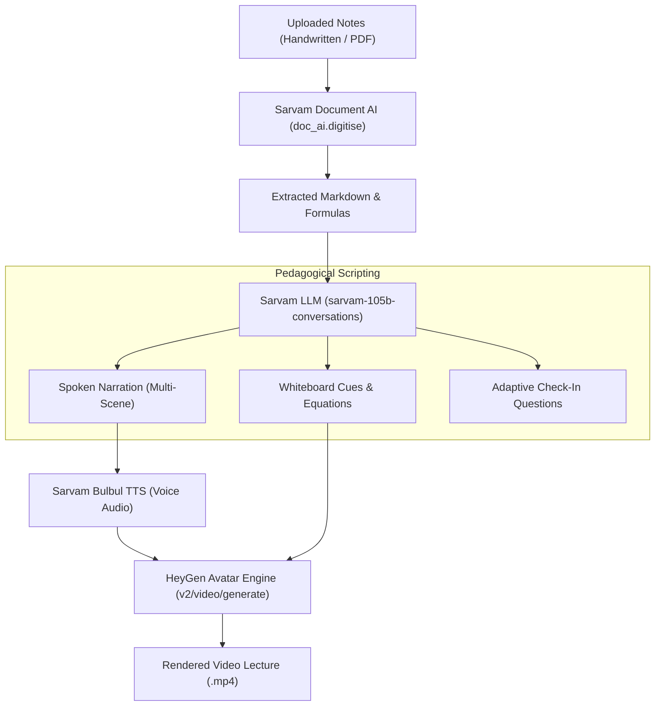

# AI Avatar Tutor — Notes-to-Video Multimodal Studio

An intelligent tutoring system powered by **Sarvam AI** and **HeyGen**. Upload handwritten notes or PDFs to automatically generate full video lectures featuring lifelike AI avatars with gestures, speech synthesis in 22+ Indic languages, dynamic interactive whiteboards with equations/diagrams, and adaptive check-in quizzes.


---

## 🌟 Key Features

* **Document Digitization (Sarvam Vision / Doc AI)**: Extracts handwritten scripts, complex mathematical formulas, and multi-column document layouts.
* **Pedagogical Storyboarding (Sarvam LLM `sarvam-105b-conversations`)**: Transforms raw notes into structured lecture scenes complete with spoken explanations and timed visual whiteboard instructions.
* **Expressive Indic Voice (Sarvam Bulbul TTS)**: Synthesizes natural teacher voices across Indian languages and accents (English, Hindi, Telugu, Tamil, Marathi, Bengali, and more).
* **Lifelike Avatar Lectures (HeyGen Video API)**: Renders talking avatars with natural hand gestures alongside interactive whiteboard slides and diagrams.
* **Live Interactive Classroom (WebRTC Streaming Avatar)**: Two-way conversational tutor session with adaptive questioning, instant feedback, and progress tracking.
* **Built-in Web Studio**: Interactive dashboard served directly at `http://127.0.0.1:8000/`.

---

## 🏗️ Architecture



---

## 🚀 Quickstart

### 1. Clone & Install Dependencies

```bash
git clone https://github.com/Yash-Lamba/ai-avatar-tutor.git
cd ai-avatar-tutor

pip install -r requirements.txt
```

### 2. Configure Environment

Copy `.env.example` to `.env` and add your Sarvam AI API subscription key:

```bash
cp .env.example .env
```

Edit `.env`:
```env
SARVAM_API_KEY=your_sarvam_api_key
HEYGEN_API_KEY=your_heygen_api_key # Optional: for live HeyGen renders
```

### 3. Start the Server & Studio

```bash
uvicorn app.main:app --reload --port 8000
```

Open your browser at:
* **Interactive Web Studio**: [http://127.0.0.1:8000/](http://127.0.0.1:8000/)
* **Swagger API Documentation**: [http://127.0.0.1:8000/docs](http://127.0.0.1:8000/docs)

---

## 🧪 Running Automated Tests

Run the end-to-end automated test suite:

```bash
python3 test_suite.py
```

Tests cover:
1. Service Health & Discovery (`GET /`)
2. Notes Upload & Multi-Scene Storyboard (`POST /api/v1/upload-notes`)
3. HeyGen Video Dispatch (`POST /api/v1/generate-video`)
4. Video Status & Stream Retrieval (`GET /api/v1/video-status/{id}`)
5. Adaptive Tutoring Feedback & WebRTC Session (`POST /api/v1/adaptive-feedback`)

---

## 📄 License

MIT License. Built with [Sarvam AI](https://www.sarvam.ai) and [HeyGen](https://www.heygen.com).
